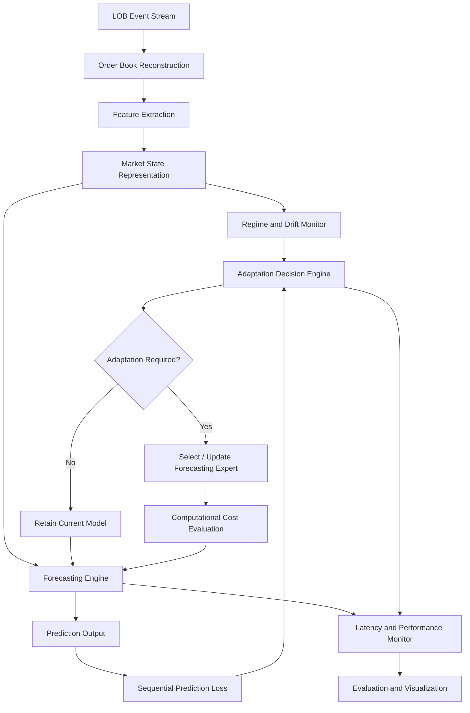

# Compute-Aware Regime-Adaptive Limit Order Book Forecasting

### Joint Optimization of Predictive Robustness, Adaptive Intelligence, and Inference Latency

<p align="center">
  <strong>Regime-Aware Machine Learning × Quantitative Finance × Systems Engineering</strong>
</p>

<p align="center">
  
  
  
  
  
</p>

---

## 1. Overview

Financial markets are inherently non-stationary. The statistical properties of market data, order-flow dynamics, liquidity distributions, and price formation mechanisms can change significantly across different market conditions.

A forecasting model trained under one set of market conditions may experience substantial predictive degradation when the underlying market dynamics change.

This project investigates the design of a **compute-aware, regime-adaptive Limit Order Book (LOB) forecasting framework** that jointly considers three fundamental objectives:

1. **Predictive Robustness:** Maintain reliable short-horizon price forecasting performance under changing market conditions.
2. **Intelligent Adaptation:** Detect distribution shifts and selectively adapt forecasting models when the evidence justifies adaptation.
3. **Computational Efficiency:** Minimize unnecessary computational overhead while satisfying explicitly defined inference-latency constraints.

Rather than treating forecasting accuracy as an isolated optimization objective, the project investigates the relationship between predictive performance, regime detection, adaptation decisions, and computational cost.

The central research question is:

> How can a limit order book forecasting system intelligently detect market-regime changes, adapt its predictive models, and allocate computational resources efficiently while maintaining reliable forecasting performance under a constrained inference-latency budget?

The proposed framework is being developed as a research-oriented project with two complementary dimensions:

- **Quantitative Research:** Market microstructure, order-book dynamics, statistical learning, regime detection, and adaptive forecasting.
- **Systems Engineering:** Event-stream processing, computational efficiency, model-switching overhead, memory utilization, throughput, and tail-latency optimization.

---

## 2. Problem Statement

### Order Book Forecasting Under Regime Shifts

A Limit Order Book represents the outstanding buy and sell interest in a financial instrument at different price levels.

It provides a detailed representation of market liquidity and the interaction between supply and demand.

However, the relationship between order-book characteristics and subsequent price movements is not necessarily stable.

Market conditions may change because of:

- Abrupt changes in volatility.
- Liquidity depletion or replenishment.
- Changes in order arrival and cancellation intensity.
- Shifts in order-flow imbalance.
- Changes in bid-ask spread and market depth.
- Structural changes in short-term price dynamics.

These changes can cause a model trained on historical observations to become less reliable.

A conventional forecasting pipeline generally follows:

**Historical Data → Feature Extraction → Model Training → Price Prediction**

The difficulty is that the forecasting model may continue operating under outdated assumptions even after the statistical characteristics of its input data have changed.

Simply introducing a drift detector does not fully solve this problem. A feature-distribution shift does not necessarily imply that the predictive relationship has deteriorated.

Similarly, retraining or switching models whenever a shift is detected may introduce unnecessary computational overhead.

This project investigates a more selective approach:

**Detect → Evaluate → Decide → Adapt → Measure**

The objective is to determine when adaptation is statistically justified and computationally worthwhile.

---

## 3. Research Objectives

The project is organized around the following objectives.

### Objective 1: Short-Horizon LOB Forecasting

Develop a forecasting pipeline that uses order-book information to predict short-term mid-price movements.

The initial prediction task considers three classes:

- Upward movement.
- Downward movement.
- Stationary movement.

### Objective 2: Distribution Shift Detection

Investigate statistical techniques for identifying changes in the distribution of incoming order-book features.

The initial approach considers rolling statistical tests, including the Kolmogorov–Smirnov (KS) test, with scope for sequential drift-monitoring methods.

### Objective 3: Predictive Degradation Monitoring

Distinguish between changes in input distributions and changes in forecasting reliability.

Monitor predictive performance sequentially as outcomes become available, allowing the system to evaluate whether detected shifts have meaningful consequences for prediction quality.

### Objective 4: Selective Regime Adaptation

Investigate an adaptive forecasting architecture that can:

- Retain the current forecasting model.
- Switch between specialized forecasting models.
- Trigger model updates when justified by statistical evidence and computational constraints.

### Objective 5: Compute-Aware Optimization

Evaluate the computational implications of monitoring, feature extraction, model switching, and model adaptation.

Study the relationship between forecasting quality, adaptation cost, and inference latency.

### Objective 6: Joint Quantitative and Systems Evaluation

Establish an experimental framework that evaluates predictive robustness and computational performance together rather than treating them as independent objectives.

---

## 4. Proposed System Architecture

The proposed architecture consists of interconnected quantitative and systems components.



### Component 1: LOB Data Ingestion

Process historical limit order book events and reconstruct the corresponding order-book states.

The ingestion pipeline will preserve chronological ordering and ensure that every prediction uses only information available at the prediction timestamp.

### Component 2: Feature Engineering

Extract relevant market microstructure features from reconstructed order-book states.

The initial feature families include:

| Feature | Description |
|---|---|
| Bid-Ask Spread | Difference between the best ask and best bid prices |
| Mid-Price | Average of the best bid and best ask |
| Order Book Imbalance | Relative difference between bid-side and ask-side depth |
| Order Flow Imbalance | Changes in buying and selling pressure |
| Market Depth | Available volume across multiple price levels |
| Realized Volatility | Rolling variability of mid-price changes |
| Event Intensity | Frequency of order-book events over a defined interval |

The feature pipeline will be designed to support both statistical monitoring and predictive modeling.

### Component 3: Forecasting Engine

The forecasting engine estimates short-horizon mid-price movements.

The initial model hierarchy is:

| Model | Purpose |
|---|---|
| Logistic Regression | Interpretable statistical baseline |
| Gradient Boosting | Nonlinear feature interactions |
| Regime-Specialized Experts | Forecasting under different market conditions |

Potential implementations include LightGBM and XGBoost, subject to experimental requirements.

The objective is to establish strong, computationally efficient baselines before introducing more complex architectures.

### Component 4: Regime and Drift Monitoring

The monitoring component investigates changes in the statistical properties of incoming market data.

Potential approaches include:

- Rolling Kolmogorov–Smirnov tests.
- Distributional divergence measurements.
- Sequential drift detection.
- Prediction-error monitoring.

An important distinction will be maintained between:

**Covariate Shift:** Changes in the distribution of input features.

**Predictive Degradation:** Changes in the forecasting model's observed predictive performance.

These phenomena are related but not equivalent.

### Component 5: Adaptation Decision Engine

The adaptation engine combines information from the drift monitor and sequential prediction-loss monitor.

It evaluates whether the current model should be retained, whether a specialized forecasting expert should be selected, or whether an update is justified.

The proposed design follows a selective adaptation principle:

> A detected distribution shift should initiate investigation, not automatically trigger computationally expensive model adaptation.

The decision mechanism will account for predictive evidence and the computational cost of the available adaptation actions.

### Component 6: Systems Performance Monitor

The systems component evaluates the operational cost of the forecasting architecture.

The primary measurements include:

- Prediction latency.
- Feature-extraction latency.
- End-to-end processing latency.
- Median and p99 inference latency.
- Event-processing throughput.
- Memory utilization.
- Model-switching overhead.
- Adaptation-related computational cost.

The objective is to understand whether predictive improvements remain meaningful under realistic computational constraints.

---

## 5. Mathematical Formulation

### 5.1 Mid-Price Definition

Let:

- \(b_t\) denote the best bid price.
- \(a_t\) denote the best ask price.

The mid-price is defined as:

\[
m_t = \frac{a_t+b_t}{2}
\]

### 5.2 Order Book Imbalance

Let \(V_t^b\) and \(V_t^a\) denote the aggregated bid-side and ask-side volumes.

A simple order-book imbalance measure is:

\[
I_t =
\frac{V_t^b-V_t^a}
{V_t^b+V_t^a+\epsilon}
\]

where \(\epsilon\) is a small positive constant.

This feature provides a normalized representation of the relative depth imbalance between the two sides of the book.

### 5.3 Short-Horizon Forecasting

Define the future mid-price movement over horizon \(h\) as:

\[
\Delta m_{t,h}=m_{t+h}-m_t
\]

The prediction target is:

\[
y_t =
\begin{cases}
+1, & \Delta m_{t,h} > \tau\\
0, & |\Delta m_{t,h}|\leq \tau\\
-1, & \Delta m_{t,h} < -\tau
\end{cases}
\]

where \(\tau\) is a predefined threshold.

The forecasting model estimates:

\[
\hat{y}_t=f_\theta(X_t)
\]

where \(X_t\) represents the information available at time \(t\).

### 5.4 Compute-Aware Adaptation

Let \(\pi\) denote the adaptation policy.

An illustrative optimization objective is:

\[
\min_{\pi}
\mathbb{E}[L_{\text{forecast}}(\pi)]
+
\lambda C_{\text{adapt}}(\pi)
\]

subject to:

\[
\operatorname{Latency}_{99}(\pi)\leq B
\]

where:

- \(L_{\text{forecast}}\): Sequential forecasting loss.
- \(C_{\text{adapt}}\): Computational cost of adaptation.
- \(\lambda\): Trade-off parameter.
- \(B\): Defined p99 latency budget.

This formulation captures the central research direction: optimizing predictive robustness while explicitly accounting for computational expense.

The precise loss function, computational-cost definition, and latency budget will be determined through the experimental design.

---

## 6. Proposed Adaptation Strategies

The framework will investigate and compare three primary adaptation policies.

| Policy | Description |
|---|---|
| Static Forecasting | Retains the initial forecasting model |
| Shift-Triggered Adaptation | Initiates adaptation following a detected shift |
| Budget-Aware Adaptation | Considers shift evidence, predictive degradation, and adaptation cost |

The comparison is intended to answer three questions:

1. Does adaptation improve forecasting performance under distribution shifts?
2. Does reacting to every detected shift introduce unnecessary computational expense?
3. Can selective adaptation preserve predictive performance while reducing computational overhead?

The adaptive architecture may use a small bank of forecasting experts, each trained on different historical conditions or data segments.

The selection and updating mechanisms will be evaluated against the non-adaptive baselines.

---

## 7. Dataset and Experimental Environment

### Primary Dataset: LOBSTER

The initial research experiments are designed around publicly accessible LOBSTER limit order book sample data.

LOBSTER provides event-level message data alongside corresponding reconstructed order-book states.

This allows the investigation of:

- Order-book evolution.
- Limit order additions and cancellations.
- Executed trades.
- Price changes.
- Multi-level liquidity distributions.
- Short-horizon market dynamics.

Dataset availability and licensing conditions will be verified before experiments are conducted.

Official resource:

https://lobsterdata.com/

### Potential Extension: Cryptocurrency Order Book Data

Exchange-provided historical or recorded order-book data may be considered for additional experiments.

This extension can help investigate whether the conclusions obtained from the primary dataset hold under different market structures.

The initial implementation will prioritize a controlled and reproducible single-dataset evaluation.

---

## 8. Experimental Methodology

A central requirement of this project is to evaluate the system under genuinely sequential conditions.

Randomly shuffling observations can introduce temporal leakage and produce misleading estimates of predictive performance.

The proposed evaluation therefore follows a chronological test-then-train protocol.

### 8.1 Chronological Evaluation

The evaluation pipeline will:

1. Train the initial model on an earlier historical period.
2. Process subsequent order-book observations chronologically.
3. Generate predictions using only currently available information.
4. Record predictions and associated processing times.
5. Evaluate predictions after their corresponding outcomes become available.
6. Update the monitoring and adaptation mechanisms using available information.
7. Continue the process across subsequent observations.

### 8.2 Controlled Distribution Shifts

Synthetic distribution changes will be introduced in controlled experiments.

These experiments will help evaluate detector behavior when the ground-truth change time is known.

Potential scenarios include:

- Changes in feature distributions.
- Changes in feature-label relationships.
- Increased observation noise.
- Changes in event intensity.

Controlled experiments will be complemented by historical market-period evaluations.

### 8.3 Historical Market Evaluation

Historical order-book periods will be examined to investigate changes in:

- Volatility.
- Liquidity.
- Spread.
- Order-flow characteristics.
- Predictive performance.

Historical changes will be characterized using observable market data rather than automatically attributed to specific economic events.

### 8.4 Ablation Studies

Ablation experiments will isolate the contribution of individual system components.

Planned comparisons include:

- Static versus adaptive forecasting.
- Feature-shift detection versus predictive-loss monitoring.
- Shift-only versus budget-aware adaptation.
- Adaptation enabled versus disabled.
- Different expert-bank configurations.
- Different monitoring frequencies and computational budgets.

---

## 9. Evaluation Metrics

The evaluation framework considers predictive quality, shift detection, adaptation effectiveness, and systems performance.

### 9.1 Predictive Performance

| Metric | Purpose |
|---|---|
| Accuracy | Overall classification performance |
| Balanced Accuracy | Performance adjusted for class imbalance |
| Macro-F1 | Class-balanced precision and recall |
| Log Loss | Quality of probabilistic predictions |

### 9.2 Regime Detection

| Metric | Purpose |
|---|---|
| Detection Delay | Time between an actual controlled shift and its detection |
| False Alarm Rate | Frequency of unnecessary shift alerts |
| Missed Detection Rate | Frequency of undetected controlled shifts |
| Detection Stability | Consistency of monitoring decisions |

### 9.3 Adaptation Effectiveness

| Metric | Purpose |
|---|---|
| Post-Shift Predictive Loss | Forecasting error following a shift |
| Recovery Time | Time required to recover from predictive degradation |
| Cumulative Predictive Loss | Total sequential loss over the evaluation period |
| Adaptation Frequency | Number of adaptation actions |
| Adaptation Cost | Computational resources consumed by adaptation |

### 9.4 Systems Performance

| Metric | Purpose |
|---|---|
| Median Latency | Typical prediction-processing time |
| p99 Latency | Tail inference latency |
| Throughput | Number of processed events per unit time |
| Memory Utilization | Memory required by the system |
| Feature Extraction Time | Cost of feature computation |
| Model Switching Overhead | Additional cost of changing forecasting experts |

### 9.5 Joint Evaluation

The primary objective is to characterize the trade-off between:

\[
\text{Predictive Robustness}
\quad \leftrightarrow \quad
\text{Computational Efficiency}
\]

The final analysis will examine whether different adaptation policies offer meaningful improvements under comparable computational budgets.

---

## 10. Research Hypotheses

The project is structured around three initial research hypotheses.

**H1 — Regime-Adaptive Forecasting**

A regime-aware forecasting policy can reduce predictive degradation following distribution shifts compared with a fixed forecasting model.

**H2 — Selective Adaptation**

Combining feature-shift evidence with sequential predictive-loss monitoring can reduce unnecessary adaptation relative to a policy that reacts to every detected shift.

**H3 — Compute-Aware Adaptation**

Explicitly accounting for adaptation cost and inference-latency constraints can improve the predictive-performance–computational-efficiency trade-off.

These are research hypotheses to be tested experimentally, not established findings.

---

## 11. Quantitative Research and Systems Engineering Integration

A defining characteristic of this project is the integration of two complementary research disciplines.

### Quantitative Research and Machine Learning

Focus areas:

- Financial market microstructure.
- Limit order book dynamics.
- Order-flow imbalance.
- Short-horizon price prediction.
- Statistical distribution shift.
- Regime detection.
- Online learning.
- Adaptive forecasting.
- Sequential model evaluation.

### Systems Engineering and Computational Performance

Focus areas:

- Event-stream processing.
- Efficient order-book reconstruction.
- Feature extraction efficiency.
- Model inference optimization.
- Model-switching overhead.
- Memory utilization.
- Throughput benchmarking.
- Tail-latency analysis.
- Computational resource allocation.

### Shared Research Objective

The two workstreams converge on one central question:

**How does computational efficiency influence the predictive robustness of an adaptive market-forecasting system?**

Rather than treating systems engineering as a separate implementation exercise, this project investigates its direct relationship with quantitative forecasting performance.

---

## 12. Proposed Technology Stack

The following technologies are candidates for the implementation.

| Area | Proposed Technologies |
|---|---|
| Programming | Python, C++ |
| Numerical Computing | NumPy, SciPy |
| Data Processing | Pandas |
| Machine Learning | Scikit-learn |
| Gradient Boosting | LightGBM / XGBoost |
| Statistical Monitoring | SciPy, custom sequential detectors |
| Visualization | Matplotlib, Plotly |
| Performance Profiling | Python profiling tools, psutil |
| Development | Jupyter Notebook, Git, GitHub |

The final stack will be determined by the implementation and benchmarking requirements.

---

## 13. Repository Structure

The following is the proposed target organization. Individual directories and modules will be added as implementation progresses.

```text
Compute-Aware-Regime-Adaptive-LOB-forecasting/
│
├── data/
│   ├── raw/
│   ├── processed/
│   └── README.md
│
├── notebooks/
│   ├── 01_data_exploration.ipynb
│   ├── 02_lob_feature_engineering.ipynb
│   ├── 03_baseline_forecasting.ipynb
│   ├── 04_regime_detection.ipynb
│   └── 05_adaptive_forecasting.ipynb
│
├── src/
│   ├── data/
│   │   ├── loader.py
│   │   └── orderbook.py
│   │
│   ├── features/
│   │   ├── imbalance.py
│   │   ├── order_flow.py
│   │   └── volatility.py
│   │
│   ├── models/
│   │   ├── baseline.py
│   │   ├── boosting.py
│   │   └── expert_bank.py
│   │
│   ├── monitoring/
│   │   ├── drift_detection.py
│   │   └── prediction_monitor.py
│   │
│   ├── adaptation/
│   │   └── adaptation_policy.py
│   │
│   ├── systems/
│   │   ├── inference.py
│   │   ├── profiling.py
│   │   └── benchmarking.py
│   │
│   └── evaluation/
│       ├── forecasting_metrics.py
│       ├── drift_metrics.py
│       └── experiment_runner.py
│
├── results/
│   ├── figures/
│   ├── tables/
│   └── benchmarks/
│
├── configs/
│   └── experiment_config.yaml
│
├── tests/
│
├── docs/
│   ├── architecture.md
│   └── methodology.md
│
├── Perceptron Hackathon Problem Approach.pdf
├── requirements.txt
├── .gitignore
└── README.md
```

---

## 14. Project Roadmap

The project will progress through the following development phases.

| Phase | Focus | Expected Deliverable |
|---|---|---|
| Phase 1 | Literature review and problem formulation | Research specification |
| Phase 2 | Dataset ingestion and reconstruction | Validated LOB data pipeline |
| Phase 3 | Feature engineering and baseline models | Initial forecasting benchmark |
| Phase 4 | Distribution shift detection | Working shift-monitoring module |
| Phase 5 | Adaptive forecasting | Regime-aware prediction pipeline |
| Phase 6 | Compute-aware adaptation | Adaptation decision mechanism |
| Phase 7 | Systems benchmarking | Latency and computational evaluation |
| Phase 8 | Experimental analysis | Ablations and comparative results |
| Phase 9 | Research extension | Integrated research manuscript |

The implementation will prioritize a reliable minimum viable system before introducing additional complexity.

---

## 15. Current Research Status

**Project status: Research development and implementation planning.**

The repository currently establishes the research direction and proposed technical methodology.

The system architecture, forecasting methods, adaptation mechanisms, and evaluation framework described above represent the proposed research design.

Experimental performance, benchmark results, and implementation milestones will be documented as they are completed and independently verified.

No predictive improvements, latency achievements, or research hypotheses should be interpreted as established results until supported by experiments.

---

## 16. Research Significance

This project investigates a fundamental challenge in data-driven financial forecasting: the ability of predictive systems to remain reliable when the statistical characteristics of the underlying market evolve.

It aims to move beyond static forecasting models by investigating the relationship between:

- Non-stationary market dynamics.
- Statistical shift detection.
- Sequential predictive monitoring.
- Selective model adaptation.
- Computational resource allocation.
- Inference-latency constraints.

The broader motivation is to understand how adaptive predictive systems should operate when both market conditions and computational resources are changing or constrained.

The intended outcome is a reproducible experimental framework that contributes to the study of robust machine learning for financial market microstructure.

---

## 17. References and Further Reading

The following resources provide a starting point for the theoretical and methodological foundations of the project.

1. Zhang, Zohren and Roberts (2019). **DeepLOB: Deep Convolutional Neural Networks for Limit Order Books.**  
   https://arxiv.org/abs/1808.03668

2. Briola, Bartolucci and Aste (2024). **Deep Limit Order Book Forecasting.**  
   https://arxiv.org/abs/2403.09267

3. **LOBSTER — Limit Order Book Data.**  
   https://lobsterdata.com/

4. **Scikit-learn Documentation.**  
   https://scikit-learn.org/

5. **SciPy Documentation.**  
   https://docs.scipy.org/

Additional literature on concept drift, sequential evaluation, online learning, adaptive systems, and computationally efficient inference will be incorporated as the research develops.

---

## 18. Contributors

**Research and Development Team**

| Responsibility | Research Area |
|---|---|
| Quantitative Research | Market microstructure, volatility, statistical learning, regime detection and adaptive forecasting |
| Systems Engineering | Data processing, inference optimization, performance profiling and computational efficiency |

Both contributors participate in the shared research design, experimentation, evaluation, and interpretation of results.

---

## 19. Acknowledgements

This project is being developed in the context of the **IIT Bombay Techfest – Perceptron Hackathon 2026**, under:

**Theme 3: Markets & Trading Intelligence**

**Problem 4: Order Book Forecasting Under Regime Shifts**

The hackathon motivates the initial problem formulation, while the broader research direction investigates the integration of quantitative forecasting and systems engineering.

---

## 20. Disclaimer

This repository is intended for academic research, experimentation, and educational purposes.

It does not constitute financial advice, investment advice, or a recommendation to trade any financial instrument.

Historical forecasting performance does not guarantee future performance. Experimental results should not be interpreted as evidence of live-market profitability or production-level trading reliability.

---

<p align="center">
  <strong>Understanding Market Dynamics. Adapting to Change. Engineering for Efficiency.</strong>
</p>

<p align="center">
  <em>Building adaptive quantitative forecasting systems under real computational constraints.</em>
</p>
